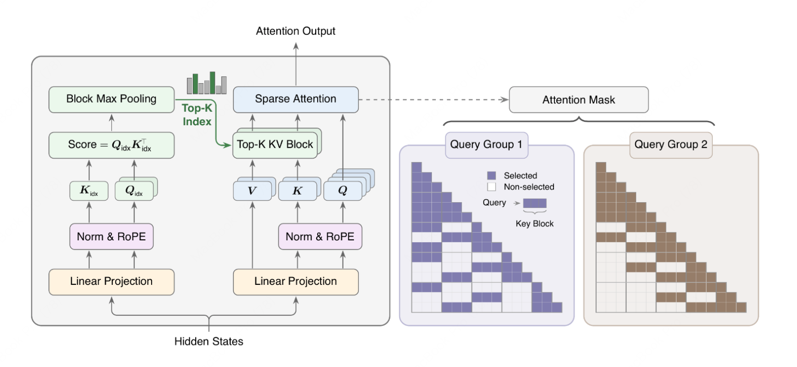

# MiniMax Sparse Attention (MSA)

[](LICENSE)
[](pyproject.toml)
[](#requirements)
[](#stack)

**MSA** (`msa_for_sail`) ships dense FlashAttention and sparse top-k attention
kernels for **PPU (HGGC)**. A single JIT-compiled stack
lives in the Python package:



> Algorithm reference: [MiniMax Sparse Attention paper](docs/MiniMaxSparseAttention.pdf).

| Stack | Path | What it gives you |
|---|---|---|
| **csrc JIT** | `python/msa_for_sail/csrc/` | Dense FMHA (`fmha_sail`, `fmha_sail_plan`) + `sparse_topk_select` indexer, compiled from Jinja templates by `jit.py` at runtime. |

> **License: MIT.** Self-authored files carry `SPDX-License-Identifier: MIT`.
> See [LICENSE](LICENSE) and [NOTICE](NOTICE). Bundled / derived third-party
> code retains its own license — see [Third-party licenses](#third-party-licenses).

## Requirements

- **Device**: PPU (HGGC).
- **Toolchain**: PPU SDK with `hgcc` on `PATH` (or `PPU_SDK` set).
- **Python**: ≥ 3.10.
- **OS**: Linux x86_64 (aarch64 untested; JIT builds may need small Makefile edits on WSL).

Quick sanity check before installing:

```bash
source /usr/local/PPU_SDK/envsetup.sh PPU   # or set PPU_SDK yourself
hgcc --version
python -c "import torch; print(torch.cuda.get_device_name(0))"
python -c "import sys; print(sys.version_info[:2])"              # ≥ (3, 10)
```

## Install

```bash
# --recursive pulls the ACTLIZE submodule (python/msa_for_sail/actlize/),
# whose headers are required for JIT/AOT compilation.
git clone --recursive https://github.com/t-head/MSA-for-sail.git msa
cd msa
# If you cloned without --recursive:
#   git submodule update --init --recursive
pip install .           # standard install (works from a wheel too)
# or
pip install -e .        # editable install for development
```

The csrc kernels are JIT-compiled at first import from sources shipped inside
the package. The `actlize` submodule is pinned to ACTLIZE v1.0.0 (`664f5c19`).

## Verify

Run a small device smoke test. **The first run JIT-compiles `sparse_topk_select`,
which takes 30 s – a few minutes on a cold hgcc cache** — this is normal, not
a hang. Subsequent runs hit the JIT cache and finish in seconds.

```bash
python tests/smoke/test_sparse_topk_forced.py
```

## Usage

```python
import torch
from msa_for_sail import fmha_sail, fmha_sail_plan, sparse_topk_select

# Page size and top-k for the sparse prefill path.
page_size, topk = 128, 16

# Dense proxy pass: compute per-block max score from a cheap Q slice.
proxy_plan = fmha_sail_plan(
    qo_lens, kv_lens, proxy_q.shape[1],
    num_kv_heads=1,
    page_size=page_size,
    output_maxscore=True,
)
_, max_score = fmha_sail(
    proxy_q, proxy_k_pages, proxy_v_pages, proxy_plan,
    kv_indices=kv_indices,
    output_o=False,
    output_maxscore=True,
)

# max_score -> sparse KV block indexes.
kv_block_indexes = sparse_topk_select(
    max_score.contiguous(), topk, num_valid_pages=num_pages,
)

# Sparse attention with the selected blocks.
sparse_plan = fmha_sail_plan(
    qo_lens, kv_lens, q.shape[1],
    num_kv_heads=k_pages.shape[1],
    page_size=page_size,
    kv_block_num=topk,
)
out, _ = fmha_sail(
    q, k_pages, v_pages, sparse_plan,
    kv_indices=kv_indices,
    kv_block_indexes=kv_block_indexes,
)
```

## Test

```bash
# Fast smoke tests.
python -m pytest tests/smoke -q

# Proxy-KV smoke test; --check also verifies the top-k multiset and the
# cosine similarity against a PyTorch sparse reference.
python tests/smoke/test_proxy_kv_smoke.py --check

# API and end-to-end integration tests.
python -m pytest tests/integration -q
python tests/integration/test_proxy_kv_e2e.py

# Large regression suites.
python tests/regression/test_correctness.py
python tests/regression/test_sparse_attn.py
python tests/regression/test_onlyscore_correctness.py
```

Use a fresh JIT cache when validating kernel changes to avoid stale artifacts:

```bash
export MINFER_FMHA_CACHE_DIR=/tmp/fmha_msa_ppu
```

PPU notes:

- FP8 sparse requires **PPU0015** (890 / M890): `sm80_fmha_sparse_fwd_mainloop.hpp`
  and `sm80_fmha_load.hpp` gate it with `static_assert(!IsFP8 || __HGGC_ARCH__ == 150)`,
  so it does not compile on PPU0010 (810E). On 890 it is covered by the sparse
  sections of `test_correctness.py`, `test_sparse_attn.py` and `test_proxy_kv_e2e.py`.
- Forced split-KV sparse cases are guarded back to `num_kv_splits=1` on PPU.
- Sparse uses `pack_factor=1` on PPU.

## Benchmark

`benchmarks/bench_sparse_attention_ops.py` covers dense prefill, paged
prefill, sparse prefill, dense decode, paged decode, sparse decode, in
`fp8` and `bf16`.

```bash
python benchmarks/bench_sparse_attention_ops.py --help     # full flag list
```

Common invocations (output is TSV):

| Goal | Command |
|---|---|
| FP8 full sweep | `python benchmarks/bench_sparse_attention_ops.py --dtype fp8 --sections all --output_mode o -o /tmp/msa_fp8.tsv` |
| BF16 full sweep | `python benchmarks/bench_sparse_attention_ops.py --dtype bf16 --sections all --output_mode o -o /tmp/msa_bf16.tsv` |
| Quick CI smoke | `python benchmarks/bench_sparse_attention_ops.py --dtype fp8 --sections prefill,decode,sparse_decode --seqs 8192,16384 --tp 1,4 --decode-k 8192,131072 --decode-b 32 --dry-run-ms 50 --repeat-ms 200 -o /tmp/msa_smoke.tsv` |
| Output-mode checks (dense/paged) | `--output_mode maxscore` or `--output_mode full` |

## Layout

```
python/msa_for_sail/                  Python package
  __init__.py                       Public re-exports
  api.py                            fmha_sail / fmha_sail_plan / sparse_topk_select
  jit.py                            Runtime JIT (hgcc + ninja) for the csrc stack
  csrc/                             CUDA kernels + Jinja templates (JIT-compiled)
    include/                        Vendored FlashInfer / CUTLASS-derived / TRT-LLM headers
  actlize/                          T-Head ACTLIZE git submodule (include/ only)
tests/                              Correctness tests
  smoke/  integration/  regression/
scripts/                            Warmup + cache-management helpers
benchmarks/                         bench_sparse_attention_ops.py
```

## Stack

- **csrc JIT** — dense FlashAttention, page KV, sparse `kv_block_indexes`
  attention, and the `sparse_topk_select` indexer. Compiled at runtime from
  `csrc/*.cu.jinja` plus `csrc/include/`. Public entry:
  `fmha_sail_plan → fmha_sail`.

## Third-party licenses

This repository is a PPU/HGGC port of MSA developed by
T-Head (Shanghai) Semiconductor Co., Ltd. The project code — upstream MSA
and the T-Head PPU additions alike — is MIT-licensed (see `LICENSE`);
per-file copyright lines identify the contributions. Third-party
components retain their original licenses. Full license texts are in
`THIRD-PARTY-NOTICES`; per-component details, file lists and provenance
are in `NOTICE`.

`msa_for_sail` bundles, derives from, or depends on the third-party components
below. Each retains its original license; this section summarizes them.
Authoritative text is shipped with each component.

### Vendored / derived source (shipped in this repo)

| Component | License | Where |
|---|---|---|
| **T-Head ACTLIZE** (CUTLASS 3.6.0 adaptation for PPU) | BSD-3-Clause | Git submodule at `python/msa_for_sail/actlize/` (only `include/` is consumed). Copyright (c) 2022–2026 T-Head (Shanghai) Semiconductor Co., Ltd.; Copyright (c) 2017–2024 NVIDIA CORPORATION & AFFILIATES; Copyright (c) 2017–2025 Advanced Micro Devices, Inc. (MIT-licensed portions). |
| **Vendored CUTLASS-derived headers** | BSD-3-Clause | `python/msa_for_sail/csrc/include/`: `pow_2.hpp` and `gather_tensor.hpp` carry Copyright (c) 2023–2025 NVIDIA CORPORATION & AFFILIATES; `fmha.hpp`, `fmha_common.hpp`, `fmha_fusion.hpp`, `fmha_options.hpp` and `fmha_tile_scheduler.hpp` carry 2024–2025. `pow_2.hpp`, `fmha.hpp`, `fmha_common.hpp`, `fmha_fusion.hpp` and `fmha_tile_scheduler.hpp` are modified for the PPU (HGGC) port and carry an additional T-Head copyright line. |
| **FlashInfer** | Apache-2.0 | Sources under `python/msa_for_sail/csrc/` and `python/msa_for_sail/csrc/include/` carrying a `Copyright (c) <year> by FlashInfer team` line: `allocator.h`, `exception.h`, `mask.cuh` (unmodified), and `vec_dtypes.cuh`, `cutlass_utils.cuh`, `utils.cuh`, `plan.cuh`, `sparse_topk_select.cuh`, `tvm_ffi_utils.h`, `fmha_cutlass_sm80.cuh` (adapted from upstream `fmha_cutlass_sm100.cuh`) — the modified files carry an additional T-Head copyright line. Sources match the flashinfer v0.6.8.post1 lineage; `plan.cuh` is from a later upstream revision. Project: <https://github.com/flashinfer-ai/flashinfer>. |
| **NVIDIA TensorRT-LLM + NAVER Corp (CLOVA)** | Apache-2.0 | Portions of `python/msa_for_sail/csrc/include/sparse_topk_select.cuh` — `indexerTopK` histogram-step + insertion-sort derived from `tensorrt_llm/cpp/tensorrt_llm/kernels/indexerTopK.cu`. Copyright (c) 2019–2026 NVIDIA CORPORATION; Copyright (c) 2021 NAVER Corp. The per-file header in `sparse_topk_select.cuh` includes a function-level provenance map. |

### Runtime dependencies (installed via pip)

| Package | Upstream | License |
|---|---|---|
| `apache-tvm-ffi` | Apache TVM FFI | Apache-2.0 |
| `torch` | <https://github.com/pytorch/pytorch> | BSD-3-Clause |
| `jinja2` | <https://github.com/pallets/jinja> | BSD-3-Clause |
| `ninja` | <https://github.com/ninja-build/ninja> | Apache-2.0 |

The exact license of each installed package is distributed with that package;
consult its metadata (`pip show <pkg>`) for the authoritative text.
